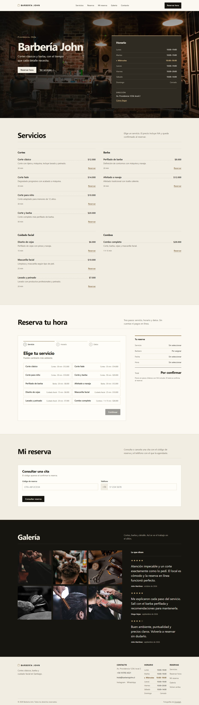
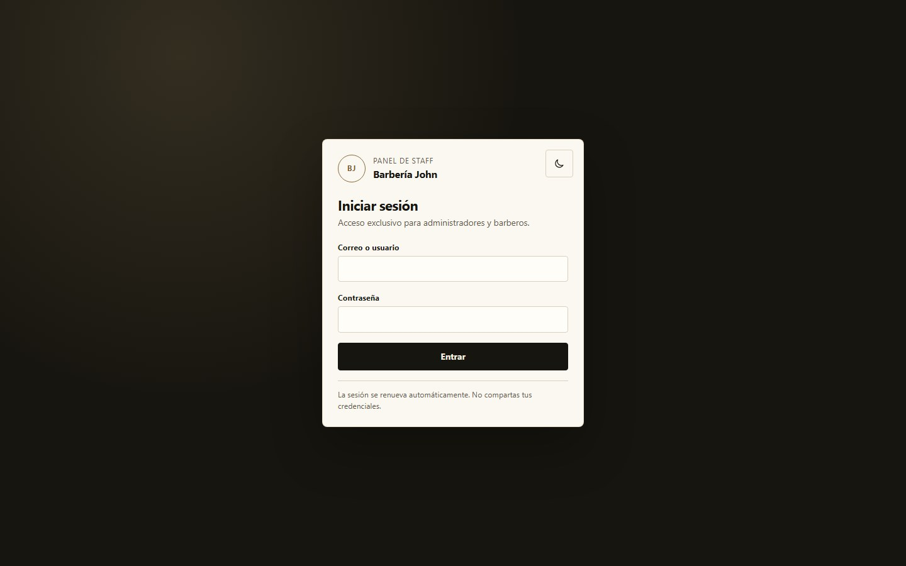

# Barbería John — Sistema de gestión full-stack

Sistema de gestión para una barbería: catálogo, barberos, horarios, reservas de invitados, agenda, clientes, caja, inventario y métricas.

## Capturas





## Stack

- **Base de datos:** Supabase (PostgreSQL + Auth + RLS).
- **Backend:** Node.js 20+ y Express con ES Modules.
- **Frontend:** HTML5 semántico, CSS3 nativo con BEM y JavaScript vanilla (ES Modules).
- **Pagos:** registro en local; sin pasarela.
- **Notificaciones:** sin envíos automáticos por ahora.
- **Ubicación:** Chile (`America/Santiago`, `es-CL`, CLP, IVA 19%).

## Estructura

```
.
├── .gitattributes
├── .github
│   ├── dependabot.yml
│   └── workflows
├── .gitignore
├── LICENSE
├── README.md
├── SECURITY.md
├── docs
│   ├── admin.md
│   ├── api.md
│   ├── frontend.md
│   ├── qa-live.md
│   ├── schema.md
│   └── screenshots
│       ├── admin-login.jpg
│       └── publico.jpg
├── frontend
│   ├── index.html
│   ├── favicon.svg
│   ├── admin
│   │   ├── index.html
│   │   └── assets
│   │       ├── css
│   │       └── js
│   └── assets
│       ├── css
│       └── js
├── supabase
│   └── migrations
│       ├── 202610200001_extensions_y_enums.sql
│       ├── 202610200002_tablas.sql
│       ├── 202610200003_funciones_triggers.sql
│       ├── 202610200004_rls.sql
│       ├── 202610200005_vistas.sql
│       ├── 202610200006_seed.sql
│       ├── 202610200007_reviews_ocultas_por_defecto.sql
│       ├── 202610200008_anulacion_ventas.sql
│       └── 202610200009_usuarios_staff.sql
└── server
    ├── .env.example
    ├── package.json
    ├── scripts
    │   ├── check.mjs
    │   ├── create-staff.mjs
    │   ├── db-check.mjs
    │   └── serve-frontend.mjs
    └── src
```

## Requisitos

- Node.js 20 o superior.
- Un proyecto de Supabase.

## Puesta en marcha

### 1. Crear el proyecto en Supabase

1. Crear un proyecto en [supabase.com](https://supabase.com) en la región más cercana.
2. Ir a **Project Settings > API** y copiar:
   - `Project URL`
   - `anon public key`
   - `service_role key` (secreta)

### 2. Ejecutar las migraciones

Opción A, SQL Editor:

Ejecutar los nueve archivos de `supabase/migrations` en orden. Cada archivo es idempotente en su primera aplicación. La migración `008` es necesaria para anular ventas y reportar pagos por barbero; la `009` agrega el login con nombre de usuario. Si el proyecto ya tiene aplicadas las migraciones `001` a `008`, basta con ejecutar `202610200009_usuarios_staff.sql`.

Opción B, Supabase CLI:

```bash
supabase link --project-ref TU_PROJECT_REF
supabase db push
```

Las migraciones usan prefijo de fecha para que la CLI las ordene correctamente.

### 3. Configurar Auth

En **Authentication > Providers > Email**, desactivar el registro público de nuevos usuarios. El staff se crea con la API de administración o con el script incluido.

### 4. Configurar el servidor

```bash
cd server
copy .env.example .env
```

Editar `server/.env`:

```env
NODE_ENV=development
PORT=4000
CORS_ORIGIN=http://localhost:5500
TRUST_PROXY=0
SUPABASE_URL=https://tu-proyecto.supabase.co
SUPABASE_ANON_KEY=tu_anon_key
SUPABASE_SERVICE_ROLE_KEY=tu_service_role_key
BUSINESS_TIMEZONE=America/Santiago
API_RATE_LIMIT_MAX=120
```

### 5. Instalar dependencias

```bash
npm install
```

### 6. Crear el primer administrador

```bash
npm run seed:staff -- --email admin@ejemplo.cl --password "TU_CLAVE_SEGURA" --username admin --name "Administrador" --role admin
```

El script deriva un usuario desde el correo si se omite `--username`. El panel acepta correo o usuario en el login.

### 7. Arrancar la API

```bash
npm run dev
```

Comprobar:

```bash
curl http://localhost:4000/api/health
```

### 8. Arrancar el frontend

En otra terminal, desde `server`:

```bash
npm run frontend
```

Abrir `http://localhost:5500` para el sitio público y `http://localhost:5500/admin/` para el panel de staff. El servidor estático no tiene dependencias y sirve `frontend/` con recarga por petición. La URL de la API se configura en el `meta api-base` de `frontend/index.html` y `frontend/admin/index.html`; por defecto apunta a `http://localhost:4000/api`.

Para que el navegador pueda llamar a la API en otro origen, `CORS_ORIGIN` debe incluir el origen del frontend. En desarrollo ya está configurado como `http://localhost:5500`.

### 9. Crear barberos y servicios

- Los servicios iniciales ya vienen en el seed.
- Crear un barbero con el script:

```bash
npm run seed:staff -- --email barbero@ejemplo.cl --password "TU_CLAVE_SEGURA" --username nombre.barbero --name "Nombre Completo" --role barbero --display-name "Nombre Visible"
```

- O iniciar sesión como admin en `/admin/` y crear el barbero desde el módulo **Barberos**.

El script crea horario de lunes a sábado, 10:00 a 19:00, si el barbero no tiene horarios. Después hay que asignarle servicios con `PUT /api/admin/barbers/:barberId/services`; sin esa asignación el barbero no aparece disponible para reservar.

## Scripts

| Comando | Uso |
|---|---|
| `npm run dev` | API con recarga automática |
| `npm start` | API en modo normal |
| `npm run frontend` | Sirve el frontend estático en `http://localhost:5500` |
| `npm run check` | Verifica sintaxis del backend y de los módulos JS del frontend |
| `npm run db:check` | Levanta PostgreSQL embebido, aplica migraciones y prueba reservas, ventas, métricas y RLS |
| `npm run smoke:live` | Valida la API contra Supabase real y deja los datos de demostración de John |
| `npm run seed:staff -- ...` | Crea o actualiza un administrador o barbero |

`smoke:live` requiere la API escuchando y crea un administrador temporal que elimina al terminar. Las operaciones de negocio pasan por HTTP. Al finalizar deja `server/.test-credentials.json` con el acceso del barbero de prueba; ese archivo se genera solo en local, está ignorado por Git y debe eliminarse después de usarlo.

`db:check` usa `embedded-postgres` como dependencia de desarrollo. En producción se puede instalar solo lo necesario:

```bash
npm ci --omit=dev
```

## Documentación

- [API completa](docs/api.md)
- [Frontend público](docs/frontend.md)
- [Panel de staff](docs/admin.md)
- [Esquema de base de datos](docs/schema.md)
- [Validación funcional en vivo](docs/qa-live.md)

## Seguridad

- `anon` no tiene acceso directo a tablas.
- El registro público está deshabilitado en Supabase Auth: los clientes reservan como invitados y las cuentas de staff se crean con `service_role`.
- El staff autenticado solo puede leer lo que le corresponde por RLS.
- Todas las escrituras pasan por la API con `service_role`.
- Las RPC de negocio están revocadas para `anon` y `authenticated`.
- Los precios, descuentos, disponibilidad y stock se calculan en PostgreSQL.
- El frontend no calcula precios ni disponibilidad: solo presenta lo que devuelve la API y vuelve a validar en el servidor al confirmar.
- El anti-overbooking se garantiza con una constraint de exclusión, no solo con lógica de aplicación.
- El login está limitado a 10 intentos cada 15 minutos por IP.
- El login acepta correo o usuario; un usuario inexistente devuelve el mismo error genérico que una contraseña incorrecta.
- En producción, configurar `CORS_ORIGIN` con el dominio real y servir la API detrás de HTTPS.

## Limitaciones conocidas

- El rate limit es en memoria: con varias instancias hace falta un almacén compartido.
- No hay envío de correos ni WhatsApp; la tabla `notifications` queda preparada.
- No hay pasarela de pago; los pagos se registran manualmente.
- El sitio público no incluye reprogramación por código: para cambiar una cita hay que cancelarla y reservar de nuevo.
- El panel no incluye cierre de caja, exportaciones CSV, notificaciones ni gestión de otros usuarios administradores. Cada staff puede cambiar su propia contraseña.
- El login con nombre de usuario y el cambio de contraseña requieren la migración `009`, ya aplicada.
- Los comprobantes son internos y no reemplazan una boleta electrónica del SII.
- No se puede revertir el pago de una cita completada desde el panel.
- Con varios barberos elegibles hay que elegir uno; la opción "cualquiera" agregada queda como mejora.

## Próxima fase

1. Validar la anulación de ventas en vivo (migraciones `008` y `009` ya aplicadas).
2. Evaluar boleta electrónica del SII si se requiere documento tributario.
3. Evaluar cierre de caja, exportaciones y notificaciones.
4. Agregar reprogramación pública por código si se decide exponerla.
5. Implementar disponibilidad agregada para la opción "cualquiera" con varios barberos.

## Licencia

Copyright (c) 2026 Sebastián Sánchez. Todos los derechos reservados.

Repositorio publicado con fines de portafolio y demostración. Para usos comerciales o colaboraciones.
